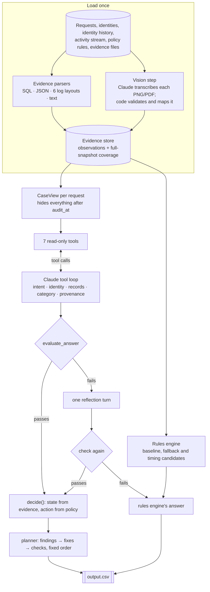

# Deletion-audit agent: finding personal data that survived deletion

A Claude agent that audits personal-data deletion requests. For each request it decides whether the
person really asked for deletion, whether the deletion is actually complete at the audit time, and, if
not, which findings, fixes and checks are needed. I built it alone in a 24-hour agent-building
challenge, HackerRank Orchestrate (October 2026).

**Bronze medal · rank 363 of 4,090 (top 9%) · 24-hour individual challenge · October 2026.**
On the full challenge set, the agent audited 518 requests in 41 minutes. Every answer passed its checks
on the first try, at about $0.12 per request (estimated from token counts).

The design rule: **Claude judges, code calculates.** The model decides what a request means, which
records belong to the person and what evidence proves it. Python decides each record's state and writes
the steps, so the model never asserts anything that can be computed.

> This repository holds my agent code with a **synthetic** dataset. The challenge dataset, problem
> statement and sample answers belong to HackerRank and are not included. The pipeline runs end to end
> on the synthetic data with no API key; the Claude path turns on when `ANTHROPIC_API_KEY` is set.

## The problem

When a customer asks a company to delete their data, a workflow runs and reports "complete". The data
often survives anyway: in a read replica, a search index, an analytics profile, a backup that can still
be restored, a support attachment, or a connector that quietly copies the record back. That leftover
copy is "ghost data".

An audit has to answer, for each request:

1. **Is it a deletion request?** "Remove me from marketing lists only" contains "remove", but it isn't one.
2. **Whose records are these?** People change email addresses; look-alike addresses belong to other people.
3. **What state is each record in, as of the audit time?** Workflow claims ("SUCCESS") are not proof.
   Only evidence counts: database snapshots, service exports, logs, notes, screenshots and PDFs.
4. **What has to happen next?** Ordered findings, fixes and checks, while respecting records the policy
   says must be kept (security audit logs, legal holds, backups).

The evidence is messy on purpose: six log layouts, SQL exports from several replicas, JSON exports,
free-text notes, and images and PDFs that only a vision model can read.

## Approach

**Claude judges, code calculates.**

| Claude decides (judgment) | Code decides (calculation) |
|---|---|
| Does the request text authorize deletion, in any language? | Who holds an identifier at a given time (exact matches only) |
| Which records belong to this person, with a cited reason for each | Each record's state: present, exposed, flow enabled, restorable |
| Each record's data category, when the evidence is ambiguous | The required action from the policy table |
| What a PNG or PDF shows (transcription only) | Mapping the transcription to records, and every step, count and order |

The model's output is a small JSON answer: authorized or not, a list of records, a category and a
provenance for each. A validator checks it. Code then turns it into steps. This keeps the model's job
small, checkable and cheap, and it removes a whole class of errors: invented steps, miscounted records,
wrong formats.

**Evidence first.** The agent has seven read-only tools. It can investigate; it cannot change anything.
Every record in an answer must cite where its link came from (an evidence file, a data-catalog row, a
workflow row on a record the evidence already ties to the person, a timing match, or a connector that
re-created it). Claims such as a workflow's "SUCCESS" never set a state.

**The time rule.** An audit can only use what was knowable at the audit time. Every case gets a
`CaseView` that hides evidence captured after its `audit_at`, and identity and ownership use the same
cutoff. A leak check re-runs every audit with all later data deleted and confirms that no answer changes.

**A fixed, safe fix order.** Steps run findings first, then fixes, then checks. Fixes follow the data's
lineage: stop the connectors that would re-create data, block restores from backup, then delete, redact
or anonymize the records. The challenge's output format requires this order; the code enforces it as a
sort key instead of trusting the model to get it right.

## Architecture



| Module | Role |
|---|---|
| `evidence/` | Parsers for SQL snapshots, JSON exports, logs and handover notes; typed `Observation` and `Coverage` records |
| `context.py` | `AuditContext` (everything loaded once) and `CaseView` (the only door to data for one case) |
| `identity.py`, `identifiers.py` | Exact identifier matching and identity history with time cutoffs |
| `linking/` | Direct links, a global timing matcher for workflow rows that carry no identifier, connector re-creation |
| `state.py`, `decisions.py`, `planner.py`, `contract.py` | State from evidence, policy actions, step rendering and validation |
| `engine_rules.py` | The deterministic engine: baseline, fallback and timing candidates for the agent |
| `agent/` | Tool loop (`llm.py`), tools, answer checks, runner with cache and replay, vision step, offline stand-in |
| `prompts/` | The investigator system prompt and the vision transcription prompt |
| `evaluation/` | Scoring, hand-built cases, leak check, output validator, usage report |
| `synthetic.py` | The synthetic dataset generator |

## Design decisions

**1. Split judgment from calculation.**
Options: let the model write the whole answer; rules only; model judges, code calculates.
I chose the split. The model's output stays small and checkable, and nothing that can be computed is
left to the model. The trade-off: adding a new kind of record means changing code, not just a prompt.

**2. My own tool loop instead of the library's.**
I call Claude through aisuite 0.2.0, a thin multi-provider client, so the model is one setting
(`provider:model`). Before relying on it I probed it offline and found that its built-in tool loop
dropped the system prompt after the first turn and kept only the first of several parallel tool calls.
So I wrote my own loop: it sends the system prompt every turn, turns off parallel tool use and caches
the growing transcript. `tests/test_aisuite_contract.py` pins this behaviour offline, so an upgrade that changes it
fails a test instead of silently changing answers. The library also can't send PDFs, so the vision step
calls the Anthropic SDK directly.

**3. Read-only tools.**
The agent can investigate and recommend; it cannot delete, redact or change anything. That keeps the
security-review surface small and leaves a person in the loop for every change.

**4. A strict audit-time cutoff, even at a cost.**
Evidence captured after the audit time can change the answer, and using it scored better on the solved
samples. On those samples, the rules engine's exact-row accuracy fell from 0.750 to 0.625 under the
strict rule. I kept the rule: an audit that uses evidence from after its own date isn't an audit. The
leak check (72 cutoffs, 550 requests, 0 answers changed) proves the rule holds.

**5. Validate, retry once, then fall back.**
Every answer is checked: shape, known ids, allowed provenance, evidence dated before the audit time,
records inside the case window, and the rendered steps. A failed answer gets one reflection turn with the
list of problems; a second failure uses the rules engine's answer. Every request gets an answer, and none
is accepted unchecked. In the full run, all 518 answers passed on the first try.

**6. Build the baseline first.**
The rules engine came before the agent. It gave me a fallback, a benchmark, and the global timing
matcher whose candidates the agent reviews. It also showed honestly how much the model added (see Limits).

**7. Cache everything, and make runs reproducible.**
Prompt caching served 93.6% of input tokens in the full run. Every model answer and every vision
transcription is cached under a key that hashes the model, the prompt, the inputs and the tool code, so
`--replay` reproduces a run with no key and no calls, and any change to inputs or code forces a fresh
answer.

**8. Vision transcribes; code interprets.**
The vision step sends only the file, with no file name or path, so the model can't guess from names. It
returns a strict JSON transcription that code validates (one retry on bad JSON). Code, not the model,
decides which record each transcribed row is and what state it shows.

## Results

From the original submission run (numbers in [`results/submission_run.json`](results/submission_run.json)):

- **Bronze medal · rank 363 of 4,090 (top 9%) · 24-hour individual challenge · October 2026** (official
  final ranking).
- **Full run:** 518 requests in 41 minutes with 8 workers; 8,303 Claude calls (about 16 per request);
  518 of 518 answers passed the checks on the first try, with no retries and no fallbacks; estimated
  cost $61.22, about $0.12 per request, at list prices from logged token counts.
- **On the 32 solved samples, which were also my development set:** status accuracy 1.000 and
  remediation-step F1 0.955 (precision 0.984, recall 0.927). Because I built against these samples, the
  scores are optimistic.
- **Build:** one Claude Code session, ten phases, under three hours from the starter repository to a
  full run of answers.

On the synthetic data in this repository, both engines score 1.000 on every metric. That is by
construction: I wrote the scenarios to exercise each code path. It shows that the pipeline runs end to
end, not how accurate it is.

## Limits

- **The agent mostly agreed with the rules engine.** On the 518 challenge requests, the two engines gave
  the same status everywhere and differed on only 2 rows, because the agent's tools expose the same
  evidence analysis the rules engine uses. The model's real contributions were intent, scope, category
  and ownership judgment, and rejecting weak links. A stronger design would give the model more room
  where code is weakest (ambiguous ownership) instead of mirroring it.
- **The timing matcher is calibrated to the challenge data.** Most workflow rows carry no identifier, so
  a global matcher assigns them to requests by timing. Its offsets were tuned on the solved samples
  (`--no-phase` is the ablation). It would need re-tuning for another system.
- **The strict cutoff misses some records.** A record whose only link to the person appears after the
  audit time can't be found. That is the price of decision 4.
- **Matching is exact by design.** A record linked only by a matching number or a similar-looking email
  is not linked. That avoids false findings but can miss real ones.
- **The offline mode is not a model.** `--offline` replaces Claude with a fixed script that calls two
  tools and returns the rules engine's records. It exercises the tool loop, the checks and the renderer;
  it does not exercise judgment.
- **Library internals.** The client wrapper patches aisuite's SDK client to record full token usage.
  The pinned versions and the contract tests guard this; a different aisuite version may break it.
- **Costs are estimates** from logged token counts at list prices, not invoices.

## How to run

Tested on Python 3.14.

```bash
make setup && source .venv/bin/activate   # or: pip install -r requirements.txt -r requirements-dev.txt && pip install -e . --no-deps
```

**No API key needed:**

```bash
make test             # 83 offline tests (pytest)
make lint             # ruff
make demo             # rules engine on the synthetic requests -> out/output.csv, then validate it
make agent-offline    # full agent pipeline with a scripted stand-in for Claude
make evaluate         # score both engines on the sample answers and 7 hand-built cases
make leak-check       # prove later evidence never changes an answer
```

**With Claude** (costs money):

```bash
cp .env.example .env                       # then put your key in .env, or export ANTHROPIC_API_KEY
python -m deletion_audit --vision          # optional: transcribe the PDF and PNG with Claude instead of the fixtures
python -m deletion_audit --engine agent    # live run; writes out/output.csv and runs/usage_report.md
python -m deletion_audit --engine agent --replay   # re-create it from the cache, no key
python -m deletion_audit.evaluation.score --engine agent --live --custom
```

Without a key, `--engine agent` exits with code 2; `--allow-fallback` uses the rules engine instead.
The key is read only from the environment (or a git-ignored `.env`), never from a flag, and is never
printed or logged. `AGENT_MODEL` (or `--model`) selects the model; the default is
`anthropic:claude-opus-5-5`. `AUDIT_DATA_DIR` points the audit at another dataset with the same layout.

Other options: `--evidence-report` prints per-file parse counts; `--no-phase` and
`--lenient-ownership` are ablations (the second breaks the time rule and is for measurement only).

## Repository layout

```text
src/deletion_audit/     the package (see the module table above); prompts/ holds both prompts
tests/                  83 offline tests; fakes.py replaces the Anthropic client
data/synthetic/         the generated dataset (see data/README.md)
results/                aggregate numbers from the original submission run
.github/workflows/      CI: lint, tests, offline runs, evaluation, leak check (no API key)
```

## License

MIT for my code (see [LICENSE](LICENSE)). The synthetic data is generated by this repository and covered
by the same license.
